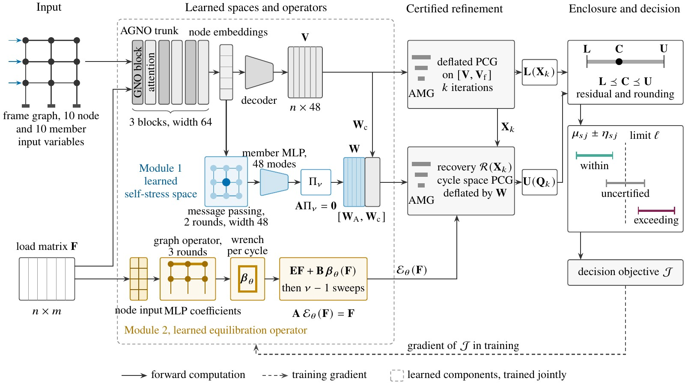

<div align="center">

# SAF-GNO

---

### Certified drift verification for agentic configuration of steel-building product families using a graph neural operator with statically admissible force fields

[](https://twakjira.github.io/SAF-GNO/)
[](#citation)
[](#data)

[Tadesse G. Wakjira](https://www.ai4riselab.com), [Hana L. Goshu](https://www.hanagoshu.com)

*Under Review*

</div>

## Overview

Configuration agents need verification tools whose decisions are correct for every proposed building. SAF-GNO
generates a displacement space and exactly equilibrated member force fields for each steel frame, refined by a few
Krylov iterations inside a Prager–Synge enclosure, and every certified drift decision is correct for any value of the
model parameters. A learned self-stress space and a learned equilibration operator reduce the iterations required for
certification.

<p align="center"></p>

SAF-GNO required 0.254 and 0.627 Krylov iterations per certified assessment on the StAnD and steel
family test datasets, 15.1% and 27.2% fewer than the best-performing graph neural network baseline and
80.2% and 85.8% fewer than multigrid preconditioned conjugate gradients, with no incorrect
certified classification. In the configuration of a product family, the certified tools processed
4,175 agent calls without an incorrect classification, whereas an uncertified learned prediction
made 268 false acceptances.
The project page is at [https://twakjira.github.io/SAF-GNO/](https://twakjira.github.io/SAF-GNO/).

## Status

Source code, the generator of the steel frame family and trained checkpoints will be released on acceptance.

## Architectural contributions

| Module | Description |
|---|---|
| M1 | Learned self-stress space of member force modes projected exactly onto the null space of the equilibrium operator |
| M2 | Learned equilibration operator, a correction linear in the loads added to the lift of the force method |

## Results

Mean Krylov iterations required for certification and certification rate after k iterations, mean of five seeds.

| Method | StAnD iterations | StAnD, k = 0 (%) | StAnD, k = 2 (%) | Steel family iterations | Steel family, k = 0 (%) | Steel family, k = 2 (%) |
|---|---:|---:|---:|---:|---:|---:|
| **SAF-GNO** | **0.254** | **89.3** | **97.4** | **0.627** | **64.7** | **95.9** |
| AGNO, stage 2 | 0.331 | 85.8 | 96.8 | 0.861 | 55.8 | 93.8 |
| FCLGA, stage 2 | 0.299 | 87.4 | 97.1 | 1.086 | 46.2 | 91.7 |
| GNN-POD, stage 2 | 0.503 | 78.8 | 95.2 | 1.451 | 36.7 | 86.7 |
| AGNO, stage 1 | 0.425 | 81.7 | 96.0 | 1.231 | 45.4 | 89.4 |
| FCLGA, stage 1 | 0.448 | 81.8 | 95.5 | 1.588 | 35.3 | 85.0 |
| GNN-POD, stage 1 | 0.462 | 81.0 | 95.3 | 1.759 | 31.7 | 82.2 |
| AMG PCG | 1.282 | 46.2 | 85.6 | 4.400 | 0.5 | 42.5 |
| Two level CG | 6.415 | 44.8 | 60.0 | 15.132 | 0.6 | 11.7 |
| PCG | 9.463 | 33.7 | 53.5 | 19.227 | 0.0 | 6.7 |

## Data

| Source | Use |
|---|---|
| [StAnD](https://github.com/zurutech/stand) | Public frames for training, validation, test and size transfer |
| Steel frame family | Industrialized steel moment frames generated with code based loads and drift limits, released on acceptance |

## Citation

```bibtex
@article{wakjira2026safgno,
  title   = {Certified drift verification for agentic configuration of steel-building product families using a
             graph neural operator with statically admissible force fields},
  author  = {Wakjira, Tadesse G. and Goshu, Hana L.},
  journal = {Under Review},
  year    = {2026}
}
```

## Authors

[Tadesse G. Wakjira](https://www.ai4riselab.com), Kennesaw State University

[Hana L. Goshu](https://www.hanagoshu.com), The Hong Kong Polytechnic University

## Development

Developed by the [AI4RISE Lab](https://www.ai4riselab.com).
